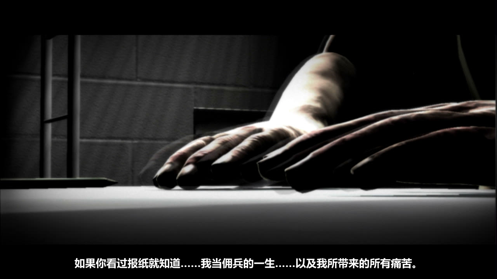
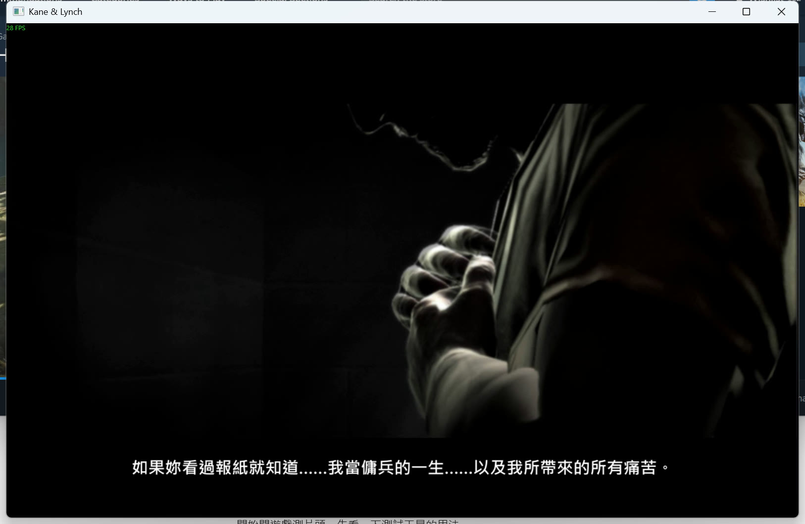

# 《Kane & Lynch: Dead Men》凯恩与林奇：死人（喋血双雄）中文化补丁（简体／繁体，单人模式）

对应 Steam 版和 GOG 版（同一份补丁通用，安装程序会自动找到游戏文件夹）。一键安装、一键还原，不用装任何软件，不改 exe。

**[⬇ 点这里到 Releases 下载 KaneLynch1_zh_v1.1.zip（约 169 MB）](https://github.com/toBerlinWay/KaneLynch1-zh/releases/latest)**

图文安装指南（Steam 社区）：https://steamcommunity.com/sharedfiles/filedetails/?id=3831427589 ｜ GOG 论坛帖：https://www.gog.com/forum/kane_lynch_series/zhongwen_yidaijianfanzhongwenhuabuding_v11_kane_lynch_dead_men_chinese_localization_patch_v11

> 请从 Releases 下载 zip。直接点绿色 Code → Download ZIP 下载到的只有安装脚本，没有补丁文件，装不了。

zip 里有两个文件夹，按需要使用：

| 文件夹 | 内容 |
|---|---|
| `KaneLynch1_简体中文补丁_v1.1` | 简体中文（大陆用语） |
| `KaneLynch1_繁體中文補丁_v1.1` | 繁体中文（台湾用语） |

## 转载说明

- **这是完整的单人模式汉化**：菜单、选项、操作提示、全部单人关卡的过场与游戏中对白字幕、任务目标都已中文化，共 3,739 句。多人模式（Fragile Alliance）没有翻译，它的在线服务也早已关闭。
- **全部文字已进行口语化精翻**：按角色语气润色，保留原作的粗口和街头口吻；繁体用台湾说法，简体由繁体转换并替换成大陆用语。
- **官方没有中文，网上也没有现成的汉化。文字和字体全部重新制作，没有使用任何旧汉化的内容，纯属个人作品。**
- 欢迎其他社区、论坛、群组转载分享（建议附上本页链接，方便大家拿到最新版）。
- **禁止其乐社区（Keylol）及其附属社区、群组与团体转载。** 不论是转贴文件、搬运到其他网盘、重新打包，还是只转贴下载链接，一律禁止；以个人名义代为转载也一样。

## 安装

1. 关闭游戏。
2. 解压 zip，进入 `KaneLynch1_简体中文补丁_v1.1` 双击 `安装简体中文.bat`（繁体：进入 `KaneLynch1_繁體中文補丁_v1.1` 双击 `安裝繁體中文.bat`）。大约 2 分钟，看到「安裝完成」就好，中途不要关窗口。
3. 游戏语言保持 English 即可。进游戏后到「选项 → 视频 → 字幕」确认字幕是开的。
4. 安装程序会自动找 Steam 和 GOG 的游戏文件夹，两个都装了会列出让你选。如果提示找不到游戏文件夹，把游戏文件夹路径粘贴进去（里面要有 kaneandlynch.exe），或者把补丁文件夹放进游戏目录（Steam：库里右键游戏 → 管理 → 浏览本地文件；GOG Galaxy：游戏 → 管理安装 → 显示文件夹）再运行一次。

简体、繁体随时可以互换，直接安装另一个就好。

**还原英文**：双击 `卸载简体中文.bat`（或 `移除繁體中文.bat`），所有改过的文件都会恢复原状，片头视频也换回原文件。

## Win10／Win11 玩不起来？

这几个问题和汉化无关，原版就有（第 1、3 条只有 Steam 版有，GOG 版不用 Games for Windows LIVE）：

- **点启动没反应**：这款游戏要 Games for Windows LIVE。先安装游戏文件夹里的 `XLiveRedist\XLiveRedist01.02.0241.00.msi`（微软签名的原版安装包）。
- **「Direct3D: Unable to create device」**：用记事本打开 `%LOCALAPPDATA%\kaneandlynch\main.ini`，在最后加一行 `Window 1`（窗口模式）；想要大窗口再加一行 `Resolution 1920x1200`。
- **第一次进游戏要建 GFWL 配置文件**：选 Create New Profile → 输入名字 → Done，不需要在线账号。
- **键盘没反应**：有手柄连着时游戏只认手柄，拔掉手柄即可。

## 截图

| 简体版 | 繁体版 |
|---|---|
|  |  |
|  |  |
|  |  |
|  |  |
|  |  |

## 注意事项

- 对应 Steam 版和 GOG 版，同一份补丁通用（GOG 版的主菜单封包和 Steam 版不同，补丁两种原文件都认）。补丁会先逐个用 SHA-256 校验游戏文件，不符合就直接拒绝，不会弄坏游戏。
- Steam「验证游戏文件完整性」、GOG Galaxy「验证／修复」或游戏更新后会变回英文，重新安装一次即可。
- GOG 版主菜单只有「战役／选项／退出游戏」三项、选项里多了「语言」，是 GOG 自己改的，和补丁无关；语言请保持 English。
- 补丁包只含改过的文字、新增的中文字体页，以及压好中文字幕的片头视频（约 60 MB，v1.1 起）；场景封包部分是差分文件，必须有正版原文件才能安装。
- 安装脚本是纯 PowerShell（Windows 10/11 自带），不联网，也只会改游戏文件夹里的 18 个场景封包和片头视频 `Movies\M00_Intro.bik`（原文件改名 .orig 留着，卸载时改回）。源码在 [`source/`](source/)，可以用记事本打开检查。杀毒软件如果提示，是因为 .bat 会调用 PowerShell 脚本。
- 语音是英文，字幕是中文。

## 片头视频与没翻译的部分

- 片头视频（凯恩写给珍妮的信）v1.1 起有中文字幕：原版任何语言都没有字幕，引擎也接不上字幕（视频是全屏覆盖层，PC 版数据里没有引擎字幕所需的界面对象），所以把字幕直接压进视频、重新编码成 Bink（1280×720，画质与原版相近），补丁因此多了约 60 MB。其他预渲染视频都是宣传片，没有对白。
- 原版就是外语的喊话（日文罗马拼音、西班牙文）照原版保留；制作人员名单、版权声明不翻。
- 多人模式保持英文。

## 已知问题

- 简体版是由繁体版用 OpenCC 转换、再替换菜单和常见用语得来的，没有另外逐句精翻，少数句子可能还带台湾口吻。欢迎回报。
- 菜单文字较长时会在空格处优先换行，个别句子换行位置不太自然。

## 技术说明（给好奇的人）

- 文字在每个场景封包（`Scenes\*.zip`）里的 `*English.LOC`（UTF-8 树状格式），直接替换英文。
- 游戏用自带的位图字体：把用到的汉字（繁体 1,599 字、简体 1,577 字）用微软正黑体／微软雅黑粗体画成 256×256 的 DXT5 字体页加进各场景的贴图包（.TEX），再更新字符表（.prm）。关卡的贴图包有内存上限，字体页不压缩会在载入关卡时闪退，所以用 DXT5。
- 封包只在文件末尾追加数据，原本的字节完全不动；卸载就是截回原长度并核对 SHA-256。补丁包只带差异数据，安装时用玩家自己的原版文件重建。
- 片头视频：用 ffmpeg＋libass 把字幕烧进每一帧，再用 RAD Video Tools 2026.09 的 Bink 1 压缩器（`RADVideo64.exe Binkc`，码率 1.0 MB/s）压回 .bik 并混回原音轨；游戏自带的 2002 年版 binkw32.dll 可直接解码。安装时整文件替换并保留原文件为 .orig，卸载时改回。
- 制作工具（Python）在另一个工作目录，这里只放安装脚本源码。

## 繁體中文說明

見 [說明_繁體.txt](說明_繁體.txt)。简体完整说明见 [说明_简体.txt](说明_简体.txt)。

## 致谢与授权

- 游戏《Kane & Lynch: Dead Men》版权归 IO Interactive 与 Eidos 所有。本补丁为非官方玩家作品，请支持正版。
- 翻译：Antigravity（Gemini）。字体、工具与测试：Claude（AI）。
- 中文字体页由微软正黑体／微软雅黑渲染成位图。
